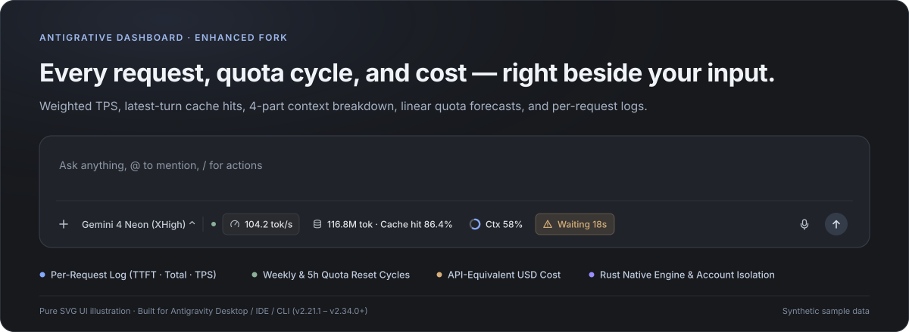
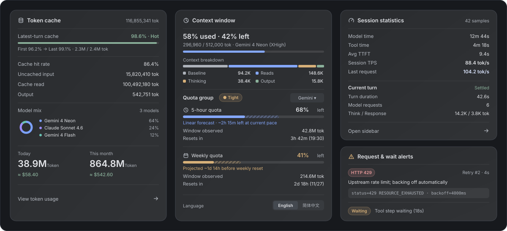
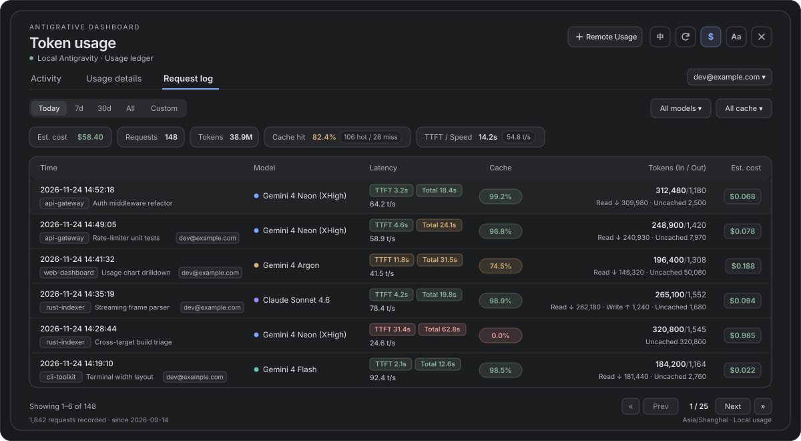
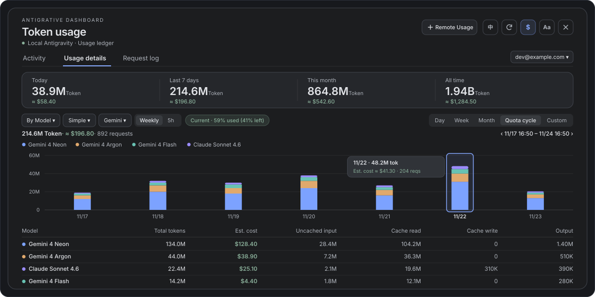

<div align="center">



# Antigrative Dashboard

Token throughput, latest-turn cache hits, 4-part context breakdown, linear quota forecasts, and per-request telemetry for Google Antigravity.<br>
Keep essential metrics visible beside your input. Hover, open the sidebar, or inspect the usage ledger for full breakdowns.

[](CHANGELOG.md)
[](COMPATIBILITY.md)
[](COMPATIBILITY.md)
[](LICENSE)

[What's New](#whats-new-in-this-fork) · [Preview](#preview) · [IDE](#antigravity-ide) · [CLI](#antigravity-cli-status-line) · [Install](#install) · [Enable or remove](#plug-and-unplug) · [Credits](#acknowledgements--inspirations) · [中文](README.zh-CN.md)

</div>

> [!NOTE]
> **Enhanced Fork Lineage:** This repository (`HelloWorldGitHub114/antigravity-dashboard`) is an independently maintained enhancement fork built on `v0.12.5` of [`ShZbz/antigravity-dashboard`](https://github.com/ShZbz/antigravity-dashboard) (an MIT continuation fork of `antigrative-dashboard` by `AG Pulse contributors`), incorporating telemetry, quota forecasting, alerting, and request-level auditing capabilities inspired by [`ATtacK030130/antigrative-dashboard`](https://github.com/ATtacK030130/antigrative-dashboard), [`Lumidarin/agy-capsule`](https://github.com/Lumidarin/agy-capsule), and [`QuantumNous/new-api`](https://github.com/QuantumNous/new-api).

> [!IMPORTANT]
> **Rust Native Engine (`pulse-accel`) Fallback:** Inherits the optional Rust N-API acceleration engine (`pulse-accel`) for fast SQLite conversation backfills, ledger indexing, and low heap overhead. To fall back to the pure TypeScript runtime, set `PULSE_DISABLE_NATIVE_ACCEL=1`. If you encounter issues in this fork, please open an issue at [GitHub Issues](https://github.com/HelloWorldGitHub114/antigravity-dashboard/issues).

## What's New in This Fork

Built directly on top of upstream `v0.12.5` while preserving full multi-account isolation, TypeScript + `esbuild` modularity, and Rust `pulse-accel` acceleration:

- **Per-Request Log Tab (`Request log`):** Filter historical requests across accounts by date (`Today`, `7d`, `30d`, `All`, `Custom`), model, or cache hit tier, with summary strip totals, per-request **TTFT (left) + Total duration (right) + overall TPS (`output / totalDuration`)** (plus quality-checked streaming TPS in hover tooltips), color-coded cache hit badges (`>90%` green, `50–90%` yellow, `<50%` red), input/cache-read/cache-write/uncached breakdowns, and per-request API USD cost.
- **Quota Reset Cycle View (`Quota cycle`):** Inspect actual usage aligned to real live or recorded reset boundaries for both **Weekly** and **5-Hour** quota pools (`Gemini` / `Claude & GPT`), complete with previous/next cycle navigation, slice-level stacked bars, drilldown totals, and cycle USD cost.
- **Linear Quota Depletion Forecast & Pace Badge:** Quota progress tracks project remaining burn trajectory with a diagonal-striped forecast tail, stabilized weekly depletion estimates, a pace badge (`Ample` / `Tight` / `May deplete early`), and observed active-window token consumption without synthetic capacity extrapolation.
- **API-Equivalent USD Cost Tracking & Custom Pricing:** Built-in public API rate schedule (including scheduled promo-to-standard transitions) with customizable per-model rate overrides via the `$` pricing modal, surfaced across the inline Token card, Usage details KPIs, Quota cycle breakdown, and Request log.
- **Actual Latest-Turn Cache Hit Rate:** Replaces the heuristic 5-minute TTL countdown with the measured latest-turn cache hit rate (`hot` / `warm` / `cold`), displaying first-hit to latest-hit trajectory and turn cached/total tokens, plus a toggleable inline chip scope (`Session` vs `Latest turn`).
- **4-Part Context Breakdown, Post-Compaction Estimate & Alert Capsule:** Breaks down active context occupancy into `Baseline`, `Tool reads`, `Thinking`, and `Output`; immediately updates context occupancy after compaction from a dynamic session baseline; adds a `Current turn` summary inside the Speed card; and surfaces HTTP error/retry diagnostics and tool-wait alerts in a dedicated composer capsule.

<details>
<summary><strong>Inherited Upstream Milestones (v0.9.0 – v0.12.5)</strong></summary>

- **v0.12.5:** Antigravity `2.34.0` support via host-injected `ANTIGRAVITY_LS_ADDRESS` / `ANTIGRAVITY_CSRF_TOKEN`, SQLite direct-read fallback, manual account switching, conversation ownership reassignment, and native `/swarm` subagent naming.
- **v0.12.3 – v0.12.4:** Antigravity `2.33.0` Redux sidebar compatibility, refactored sidebar header concentric quota rings, `Aa` font scaling, embedded Usage stats modal, and Rust-accelerated project stats (`project-ledger-v1.bin`).
- **v0.12.0 – v0.12.2:** Rust N-API native engine (`pulse-accel`), SQLite direct-read bypass, binary ledger cache (`ledger-compact-v1.bin`), By Project conversation drilldown, and standalone `ag-pulse-statusline` CLI binary.
- **v0.9.0 – v0.11.0:** Full TypeScript + `esbuild` refactor (`src/`), Cloud Remote Agent support, Hybrid Orchestrator rings, opt-in structural model call timeline (`modelTimelineEnabled`), multi-account isolation (`By Model` / `By User` / `Simple` / `Detailed`), 24-hour trend spline charts, and hierarchical Subagent/Swarm trees. See [CHANGELOG.md](CHANGELOG.md).

</details>

## Preview

### Inline Cards: Latest-Turn Cache, Quota Forecast, Speed Turn Summary & Alert Capsule



### Per-Request Log Tab (`Request log`)



### Quota Reset Cycle View (`Quota cycle`) & API USD Cost



<table>
<tr><th width="50%">Subagent & Swarm status tree</th><th width="50%">Opt-in structural model call timeline</th></tr>
<tr>
<td width="50%" valign="top"></td>
<td width="50%" valign="top"></td>
</tr>
<tr><th width="50%">Daily & weekly activity heatmap</th><th width="50%">24-hour trend & variant drilldown</th></tr>
<tr>
<td width="50%" valign="top"></td>
<td width="50%" valign="top"></td>
</tr>
</table>

<sub>Top showcase SVGs are pure vector renders of the current UI with synthetic privacy-safe data; the secondary panel/heatmap captures originate from the upstream desktop renderer (`ShZbz` / `AG Pulse contributors`).</sub>

## Key Capabilities at a Glance

| See true request latency | Forecast shared quotas | Track every token, cycle & dollar |
| --- | --- | --- |
| Session/last-request TPS, TTFT vs total duration, overall request TPS, current-turn breakdown, and retry/wait alert capsule. | Separate Gemini and Claude/GPT quota groups with linear depletion forecast stripes, pace badges, and observed cycle token volume. | Latest-turn cache hit trajectory, 4-part context breakdown, Weekly/5h quota cycle views, per-request log filters, and API USD pricing. |

### Architecture & Ergonomic Details

- **Token usage & multi-model rings.** Displays total tokens, session cache hit rate, latest-turn cache hit rate (`First → Last` trajectory), and a `36px` Top-3 multi-model SVG donut ring whenever 2+ models participate (paired with a `78px` interactive breakdown in the side panel).
- **Hybrid Orchestrator awareness.** Recognizes `Orchestrator (Argon)` (`M668`), `Gemini Flash` (`M669`), Gemini 4 Neon/Argon/Hydrogen/Carbon, and Claude aliases, surfacing planner/worker quota-split notes when planner and active models differ.
- **Hierarchical Subagent & Swarm tree.** Displays multi-level delegated subagents (`invokeSubagentSpec`) with semantic status dots, localized status labels, per-agent TPS, token counts, circular context occupancy rings, and expandable metrics.
- **Opt-in structural model call timeline (`modelTimelineEnabled`).** Disabled by default with zero `timeline-v1` disk writes. When enabled in the side panel, records strictly structural metadata (no prompts, responses, or thinking text) into `Plan` / `Worker` / `Tools·Agents` swimlanes bounded to `<= 400` nodes / `<= 192 KiB`.
- **Cloud Remote Agent & long-conversation resilience.** Supports `v1/default/jetski_remote_agents_3p/...` remote sessions with 50-step tail cold loading, `64 KiB` streaming Connect+JSON projection, and `8 MiB` `WeakRef`-bounded caches.
- **Live theme adaptation & local-only privacy.** Adapts live to Antigravity's light/dark theme and seed colors. All telemetry, pricing overrides, and usage ledgers stay strictly on loopback endpoints and local disk.

## Antigravity IDE

This repository includes a standalone VSIX adapter under `ide/` for Google's Antigravity IDE. Build the VSIX from source with `npm run package` (producing `dist/antigrative-dashboard-ide-<version>.vsix`), then choose **Install from VSIX…** in the IDE's Extensions view.

Fully quit the IDE, then start it with `--remote-debugging-port=0 --remote-debugging-address=127.0.0.1` so the inline composer bar and usage modal can attach cleanly. See [ide/README.md](ide/README.md) for diagnostics and cleanup.

## Antigravity CLI status line

An independent adapter for the official Antigravity CLI `statusLine` interface displays context occupancy, cache read tokens, state, and grouped quotas with terminal-width adaptation (**green ≥70%, yellow 30–70%, red <30%**). Preview with `node cli/statusline.mjs --preview` and install with `node manage.mjs install-cli` (`python manage.py install-cli` fallback). See [docs/CLI.md](docs/CLI.md).


<sub>Illustrative Linux Antigravity CLI 1.3.3 session capture from upstream documentation (`AG Pulse contributors`) showing 95.7% current-request cache share.</sub>

## Install

The commands below install the **desktop App adapter** from this repository. Standalone IDE users should follow [Antigravity IDE](#antigravity-ide).

Supported hosts: **Windows, Linux, and macOS; Antigravity desktop App 2.21.1 – 2.34.0+; Node.js 20+ (or bundled Electron runtime via `install.ps1` / `install.sh`) or Python 3.10+**.

> The inline model-row widget attaches cleanly via Antigravity's local sidecar and renderer debugging endpoint without modifying `resources/app.asar`. The native side panel remains a persistent companion and fallback.

Clone this fork into a permanent directory and run the installer:

```powershell
git clone https://github.com/HelloWorldGitHub114/antigravity-dashboard.git
cd antigravity-dashboard
node manage.mjs install
```

You can also run `./install.ps1` on Windows, `sh install.sh` on Linux/macOS, or `python manage.py install` (`python3` on Linux/macOS). Never run the installer with `sudo`.

Fully quit and reopen Antigravity. Open a conversation: the telemetry strip appears beside the model selector. **Keep the cloned directory** for enable, disable, update, and uninstall commands. (When running directly from source without prebuilt `.node` addons, the pure TypeScript runtime runs automatically, or you can compile `native/pulse-accel` if a Rust toolchain is installed.)

<details>
<summary><strong>Ask an agent to install it</strong></summary>

```text
Install and enable Antigrative Dashboard from this repository on this computer.
Repository: https://github.com/HelloWorldGitHub114/antigravity-dashboard
1. Read README.md, COMPATIBILITY.md, docs/CLI.md and ide/README.md. Inspect the OS,
   available executables, host versions and existing dashboard configuration with
   read-only checks. Distinguish desktop App, Antigravity CLI (agy) and standalone
   Antigravity IDE.
2. Before cloning or changing settings, summarize detected hosts and ask me to confirm
   the target: App, CLI or standalone IDE.
3. Clone https://github.com/HelloWorldGitHub114/antigravity-dashboard.git into a
   permanent directory (do not install or modify the host application itself).
4. Use Node.js 20+ (node manage.mjs ...) or Python 3.10+ (python/python3 manage.py ...):
   - App: check node manage.mjs status, then node manage.mjs install.
   - CLI: check agy --version and Node.js 20+, then node manage.mjs install-cli
     (preserving any existing statusLine via backup/override flow).
   - Standalone IDE: run npm run package to build dist/*.vsix, then install through
     Install from VSIX... or node ide/manage.mjs install --exe <IDE-exe> --vsix <VSIX>.
5. Preserve unrelated settings and saved data. If a restart is needed, tell me first
   without interrupting running tasks.
6. Verify the selected adapter in its real host, and report plugin/host versions, path,
   checks performed, and how to disable or uninstall it.
```

</details>

## Plug and unplug

### Open the App side panel

Click **Open sidebar →** inside the Session statistics hover card, or open the right auxiliary pane and choose **+ → Extensions → Antigrative Dashboard**.

Run these commands from the repository directory (`node manage.mjs <action>` or `python manage.py <action>`; add `--instance (all|pro|vertex)` to target a specific local instance):

| Action | Command | What happens |
| --- | --- | --- |
| Install or update | `node manage.mjs install` | Copy runtime adapter; preserve settings and saved statistics |
| Disable | `node manage.mjs disable` | Disable the plugin and hide the inline strip |
| Enable | `node manage.mjs enable` | Start the plugin and restore controls |
| Inspect | `node manage.mjs status` | Check installation, enabled state, and attachment health |
| Uninstall | `node manage.mjs uninstall` | Remove plugin runtime; retain saved statistics and backups |

First installation, code updates, and uninstall require a full app restart; `enable`/`disable` apply without reinstalling. `./uninstall.ps1` / `sh uninstall.sh` runs uninstall, and `node manage.mjs install --panel-only` installs only the side panel.

## How the numbers work

| Metric | Definition |
| --- | --- |
| Context window | Latest request-start `estimatedTokensUsed` / `maxContextTokens`, immediately updated post-compaction from dynamic session baseline |
| Context breakdown | Splits active context into `Baseline`, `Tool reads`, `Thinking`, and `Output` |
| Session cache hit | Cached reads ÷ (uncached input + cache reads + cache writes), token-weighted across eligible requests |
| Latest-turn cache hit | Measured cache share for the most recent turn (`First → Last` progression; green `hot`, yellow `warm`, red `cold`) |
| Request log cache tiers | Green `> 90%`, Yellow `50–90%`, Red `< 50%` (`cachedRead / totalInput`) |
| Session / Last TPS | Quality-checked output tokens ÷ streaming duration across settled requests |
| Request log latency & TPS | Left pill: `TTFT`, right pill: `Total` duration; sub-line: overall request TPS (`output / totalDuration`), with quality-checked `streamTps` in hover tooltip |
| Quota forecast & cycles | Linear burn projection from active-window samples; Quota cycle aligns slice bars to live/recorded reset boundaries (`Weekly` / `5h`) |
| Est. API USD cost | Computed from per-request uncached input, cache read, cache write, and output tokens using the editable price table |

Request metrics poll every ~2.2s, quotas refresh every 60s, and countdowns tick every second. Timing quality quarantines split token scopes, duplicate collisions, and short buffered tool windows (`< 5s` stream, `TTFT >= 1s`, `TTFT / duration >= 12`) from session TPS; see [docs/TPS.md](docs/TPS.md).

## Saved conversation statistics & long conversations

Completed-request TPS, timing metadata, cache counts, model usage, and context baselines are saved automatically under `~/.gemini/antigravity/sidecar_data/antigravity-pulse/panel/data/history-v1/<account-hash>/<conversation-id>.json`. Long local and Remote Agent transcripts use paginated step reads (`includeMessages: false`), `64 KiB` streaming JSON projection, and `8 MiB` `WeakRef`-bounded caches without storing prompt text or tool outputs. See [docs/CONTEXT_LIMITS.md](docs/CONTEXT_LIMITS.md) and [docs/LONG_CONVERSATIONS.md](docs/LONG_CONVERSATIONS.md).

## Local Token usage

Open the cache icon hover card and click **View token usage** (or use **Usage stats** in the side panel):

- **Activity tab:** Daily and weekly contribution heatmaps.
- **Usage details tab:** Stacked bar charts by **Day**, **Week**, **Month**, **Quota cycle** (`Weekly` / `5h` aligned to live/recorded pool reset windows), or **Custom** date range with single-bar drilldown; **By Model** / **By User** / **Project Stats** dimension switching; **Simple** / **Detailed** variant grouping; 24-hour trend spline charts; API USD cost summaries (with customizable `$` rate table); `Aa` font scaling (`80%`–`150%`); and **Remote Project Manual Usage** logging.
- **Request log tab:** Paginated per-request ledger inspector with date range, model, and cache-tier filters (`>90%` / `50–90%` / `<50%`), summary KPI strip, `TTFT` + `Total` latency pills with overall TPS, per-request token/cache breakdown, and API USD cost.
- **Multi-account isolation:** Switch cleanly between individual accounts (`accounts-v1.json`) or **All Accounts (Aggregated)** via `ownership-v1.json` deduplication and binary ledger caches (`ledger-compact-v1.bin` / `project-ledger-v1.bin`).

Desktop ledger: `~/.gemini/antigravity/sidecar_data/antigravity-pulse/panel/data/usage-v1/`. See [docs/USAGE.md](docs/USAGE.md).

## Acknowledgements & Inspirations

Grateful thanks to the upstream maintainers and the three open-source projects whose designs and telemetry ideas inspired this enhanced fork:

| Project | Role & Contributions Inspired |
| --- | --- |
| [**ShZbz/antigravity-dashboard**](https://github.com/ShZbz/antigravity-dashboard) | Direct fork upstream (`v0.12.5`): TypeScript + Rust `pulse-accel` architecture, SQLite direct-read bypass, multi-account isolation, project stats, sidebar refactor, and Antigravity 2.34+ support (continuation of MIT `antigrative-dashboard` by `AG Pulse contributors`). |
| [**ATtacK030130/antigrative-dashboard**](https://github.com/ATtacK030130/antigrative-dashboard) | Inspired the linear quota depletion forecast (striped projection tail on quota tracks), pace badge, and active-window observed token metrics. |
| [**Lumidarin/agy-capsule**](https://github.com/Lumidarin/agy-capsule) | Inspired the 4-part context composition breakdown, current-turn speed summary, request error/retry & long-wait alert capsule, and turn cache-hit status indicator. |
| [**QuantumNous/new-api**](https://github.com/QuantumNous/new-api) | Inspired the per-request log table layout, dual-pill latency column (`TTFT` + `Total` + overall TPS), token cache breakdown sub-line, and color-coded cache hit badges. |

## Compatibility

Base `v0.12.5` is verified on **Windows Desktop App 2.21.1 – 2.34.0+** and standalone **Antigravity IDE 2.5.5**; fork enhancements (`Request log`, `Quota cycle`, `API USD cost`, `Latest-turn cache hit`, `4-part context breakdown`, and `Quota forecast`) are actively verified on Windows Antigravity Desktop App 2.34.0+ with automated Node test coverage. Linux and macOS retain cross-platform CI scripts from upstream. See [COMPATIBILITY.md](COMPATIBILITY.md).

## FAQ

<details><summary><strong>The strip did not appear after installation.</strong></summary>

Fully quit the main Antigravity process and reopen it. Run `node manage.mjs status` (or `python manage.py status`). Check `~/.gemini/antigravity/sidecar_data/antigravity-pulse/panel/logs/sidecar.log` and `data/integration-state.json`.

</details>

<details><summary><strong>Why is the request-log TPS sometimes lower than pure streaming TPS?</strong></summary>

In the Request log, row TPS uses overall speed (`outputTokens / totalDuration`, including TTFT), matching API gateway log conventions; hover the latency cell to see the quality-checked pure streaming TPS (`outputTokens / streamingDuration`).

</details>

<details><summary><strong>How are API USD costs calculated, and can I customize rates?</strong></summary>

Costs multiply each request's uncached input, cache read, cache write, and output tokens against public API pricing (`src/shared/model-pricing.ts`, including scheduled promo-to-standard transitions). Click the `$` button in the top-right corner of the Token usage modal to override any model's rates locally.

</details>

<details><summary><strong>What happens after an Antigravity host update?</strong></summary>

Host updates do not overwrite the installed adapter in your user plugin directory, and the sidecar automatically rediscovers ports, `ANTIGRAVITY_LS_ADDRESS` / `ANTIGRAVITY_CSRF_TOKEN` environment credentials, and renderer targets. See [docs/ROBUSTNESS.md](docs/ROBUSTNESS.md).

</details>

## Development and releases

```powershell
npm run typecheck
npm run build
npm test
node tools/build.mjs --check
npm run package
```

All TypeScript sources live under `src/` (`contracts`, `shared`, `platform`, `telemetry`, `ui`, `lifecycle`) and compile via `tools/build.mjs` (`esbuild`) into zero-dependency runtime bundles across `sidecars/panel/`, `compat/`, `ide/`, `cli/`, and `manage.mjs`. Regenerate README vector previews with `node tools/generate-readme-svgs.mjs`. See [docs/DEVELOPMENT.md](docs/DEVELOPMENT.md) and [CHANGELOG.md](CHANGELOG.md).

## License

Source is released under the [MIT License](LICENSE). Third-party acknowledgements belong to their respective maintainers listed above.
