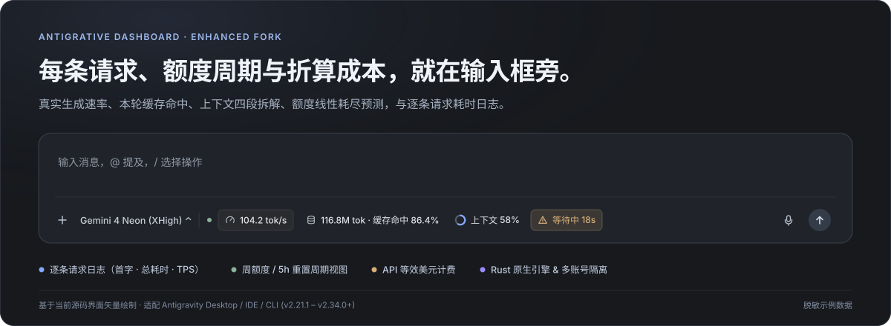
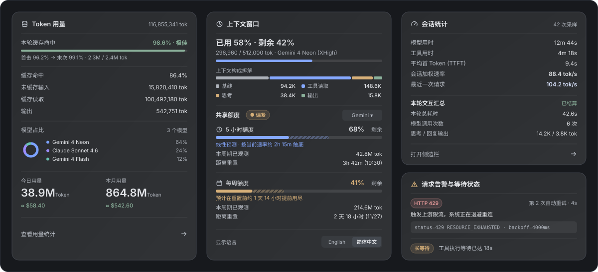
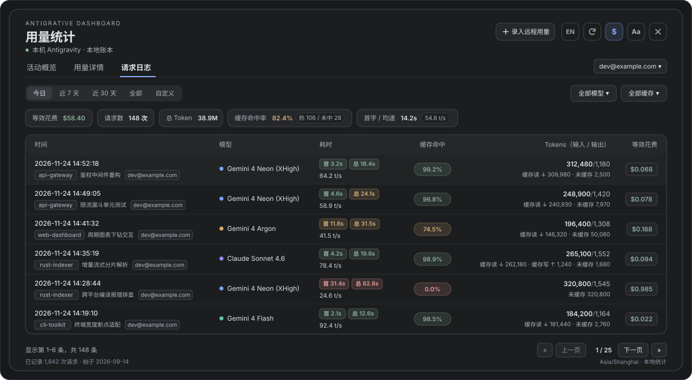
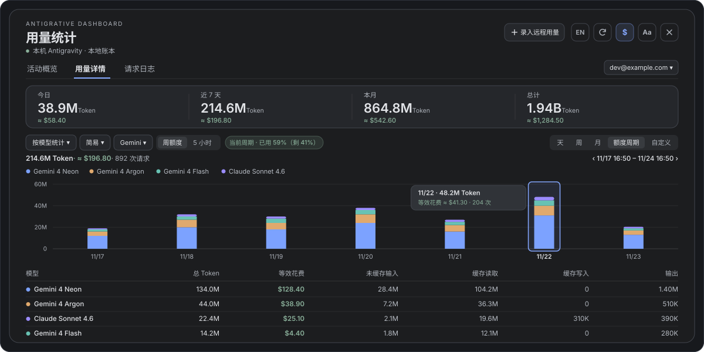

<div align="center">



# Antigrative Dashboard

为 Google Antigravity 打造的输入框旁实时监控条与本地用量审计大盘。<br>
常驻展示生成速率、本轮缓存命中与上下文占用；支持悬停展开额度预测、侧边栏协同树，以及逐条请求耗时日志与 API 折算费用统计。

[](CHANGELOG.md)
[](COMPATIBILITY.md)
[](COMPATIBILITY.md)
[](LICENSE)

[本版增强](#本版增强特性) · [效果预览](#效果预览) · [IDE](#antigravity-ide) · [CLI](#antigravity-cli-状态栏) · [开始安装](#安装) · [启停与卸载](#可插拔) · [致谢与借鉴](#致谢与借鉴来源) · [English](README.md)

</div>

> [!NOTE]
> **增强分支说明：** 本仓库（`HelloWorldGitHub114/antigravity-dashboard`）基于 [`ShZbz/antigravity-dashboard`](https://github.com/ShZbz/antigravity-dashboard) `v0.12.5` 版本独立开发与维护（后者继承自 MIT 协议项目 `antigrative-dashboard` / `AG Pulse contributors`），并参考吸收了 [`ATtacK030130/antigrative-dashboard`](https://github.com/ATtacK030130/antigrative-dashboard)、[`Lumidarin/agy-capsule`](https://github.com/Lumidarin/agy-capsule) 与 [`QuantumNous/new-api`](https://github.com/QuantumNous/new-api) 的多项设计思路，新增逐条请求日志、真实额度重置周期、耗尽线性预测与 API 折算费用核算等功能。

> [!IMPORTANT]
> **Rust 原生引擎（`pulse-accel`）回退说明：** 本版本完整保留底层 Rust N-API 原生加速引擎，用于加速 SQLite 轨迹回填与二进制账本查询。如需回退至纯 TypeScript 模式，可设置环境变量 `PULSE_DISABLE_NATIVE_ACCEL=1`。使用本增强版遇到问题欢迎提交至 [GitHub Issues](https://github.com/HelloWorldGitHub114/antigravity-dashboard/issues)。

## 本版增强特性

在完整保留上游 `v0.12.5` 多账号隔离、TypeScript + `esbuild` 模块化架构及 Rust 原生加速的基础上，新增六项核心增强：

- **逐条请求日志（`请求日志`）：** 支持按时间范围（`今日` / `近 7 天` / `近 30 天` / `全部` / `自定义`）、模型与缓存命中档位筛选；顶部汇总条展示等效花费、请求数、总 Token、加权缓存命中率与均值耗时；表格直观呈现 **首字耗时（左） + 总耗时（右） + 综合 TPS（`输出 / 总耗时`）**（悬停显示去噪纯流式速率），并按 **绿色 `>90%` / 黄色 `50–90%` / 红色 `<50%`** 分档高亮缓存命中徽章与单次请求 API 花费。
- **额度重置周期视图（`额度周期`）：** 在用量详情中支持按真实实时或历史记录的额度重置边界切片统计，覆盖 **周额度** 与 **5 小时** 双窗口及 `Gemini` / `Claude & GPT` 独立配额池，支持前后周期翻页、单柱下钻与周期费用汇总。
- **额度线性耗尽预测与节奏徽章：** 在 5h / 周额度进度条末端叠加斜纹耗尽预测段（针对周额度做了稳定性平滑），搭配消耗节奏徽章（充裕 / 偏紧 / 预计提前耗尽），并直接展示当前重置窗口实测已观测 Token 量，不做无依据的容量外推。
- **API 等效美元计费与自定义单价（`$`）：** 内置公开 API 参考单价表（支持按请求日期自动切换优惠价与标准价），可通过用量大盘右上角 `$` 按钮逐模型自定义单价；折算美元费用联动展示在底栏悬停卡、用量概览 KPI、额度周期明细与逐条请求日志中。
- **本轮真实缓存命中率：** 用当前/最近一轮交互的真实实测缓存命中率取代固定的 5 分钟 TTL 倒计时估值，直观呈现 **首击 → 末次** 命中轨迹与本轮缓存读/总输入量，并支持内联底栏在 `整场会话` 与 `最近一轮` 视图间切换。
- **上下文四段拆解、压缩后动态估算与告警胶囊：** 将活跃上下文拆分为 `基线`、`工具读取`、`思考`、`输出` 四段堆积条；对话执行 compact 压缩后基于动态会话基线立即刷新上下文占用估计；在会话统计卡增加 `本轮交互汇总`；并在底栏增加异常重试（如 HTTP 429 退避诊断）与长等待提示胶囊。

<details>
<summary><strong>继承自上游的功能演进（v0.9.0 – v0.12.5）</strong></summary>

- **v0.12.5：** 全面适配 Antigravity `2.34.0+` 环境变量凭据注入（`ANTIGRAVITY_LS_ADDRESS` / `ANTIGRAVITY_CSRF_TOKEN`）、离线 SQLite 直读兜底、手动账号切换与会话归属迁移、原生 `/swarm` 子代理实名。
- **v0.12.3 – v0.12.4：** 适配 Antigravity `2.33.0` 侧边栏派发、重构侧边栏标题栏同心圆环额度胶囊、`Aa` 三端独立字体缩放与内嵌用量统计弹窗。
- **v0.12.0 – v0.12.2：** 引入 Rust N-API 原生加速引擎（`pulse-accel`）、SQLite 零 RPC 直读旁路、二进制账本缓存、项目级会话下钻统计及 `ag-pulse-statusline` 原生 CLI 二进制。
- **v0.9.0 – v0.11.0：** 完成全栈 TypeScript + `esbuild` 重构、Cloud Remote Agent 远端会话采集、Hybrid Orchestrator 协同识别、可选结构化模型调用时间线、24 小时平滑趋势折线图及多级 Swarm 状态树。详见 [CHANGELOG.md](CHANGELOG.md)。

</details>

## 效果预览

### 内联悬停详情卡：本轮缓存与计费、上下文四段拆解与额度预测、本轮汇总与告警胶囊



### 逐条请求日志（`请求日志` 标签页）



### 额度重置周期视图（`额度周期` 模式）与明细拆解



<table>
<tr><th width="50%">子代理与 Swarm 状态树</th><th width="50%">可选结构化模型调用时间线</th></tr>
<tr>
<td width="50%" valign="top"></td>
<td width="50%" valign="top"></td>
</tr>
<tr><th width="50%">每日 / 每周活动热力图</th><th width="50%">24 小时趋势折线与变体归并</th></tr>
<tr>
<td width="50%" valign="top"></td>
<td width="50%" valign="top"></td>
</tr>
</table>

<sub>上方三张主预览图为基于当前界面代码结构与脱敏示例数据生成的纯矢量 SVG；下方四张侧栏与热力图源自上游文档实机采集示意（`ShZbz` / `AG Pulse contributors`）。</sub>

## 核心能力一览

| 看见真实耗时与速率 | 预判共享额度走势 | 账本审计与成本透明 |
| --- | --- | --- |
| 会话加权与最近请求 TPS、首 Token 延迟、总耗时、本轮汇总，以及 HTTP 限流重试 / 长等待实时告警。 | Gemini 与 Claude/GPT 独立配额组、斜纹线性耗尽预测、节奏徽章与周期重置倒计时。 | 本轮缓存命中轨迹、四段上下文拆分、周额度 / 5h 周期视图、逐条请求日志筛选与 API 折算美元费用。 |

### 细节设计

- **Token 用量与多模型占比环：** 展示累计总 Token、会话加权缓存命中率、本轮缓存命中率（含 `首击 → 末次` 变化）与 `36px` Top-3 多模型 SVG 环形图（侧边栏联动提供 `78px` 交互式分布图）。
- **Hybrid Orchestrator 混合模型识别：** 精确识别 `Orchestrator (Argon)`（`M668`）、`Gemini Flash`（`M669`）、Gemini 4 Neon/Argon/Hydrogen/Carbon 与 Claude 别名，并在规划与执行分属不同配额池时给出提示。
- **多级子代理与 Swarm 状态树：** 自动解析 `invokeSubagentSpec` 委派子代理层级、语义化状态圆点、独立速率、Token 总量与圆形上下文占用环。
- **可选结构化模型调用时间线（`modelTimelineEnabled`）：** 默认关闭，零磁盘写入；开启后仅保存结构化元数据（不含对话文本或路径），按 `Plan` / `Worker` / `Tools·Agents` 泳道呈现，磁盘占用上限 `<= 400` 节点 / `<= 192 KiB`。
- **云端 Remote Agent 与长对话优化：** 支持 `v1/default/jetski_remote_agents_3p/...` 远程会话，50 步尾部冷读、`64 KiB` 流式投影与 `8 MiB` `WeakRef` 有界缓存。
- **主题自适应与本机隐私：** 自动跟随宿主深浅色与强调色调；全部数据通过本机回环端口采集并保存在本地磁盘，不上传任何第三方服务器。

## Antigravity IDE

仓库在 `ide/` 下提供独立 IDE VSIX 适配源码。在本地执行 `npm run package` 即可生成 `dist/antigrative-dashboard-ide-<version>.vsix`，在 Antigravity IDE 扩展面板中选择「从 VSIX 安装」。

完全退出 IDE 后，通过 `--remote-debugging-port=0 --remote-debugging-address=127.0.0.1` 参数启动，即可在输入框旁与扩展视图正常挂载统计面板。详见 [ide/README.md](ide/README.md)。

## Antigravity CLI 状态栏

内置独立的 CLI 官方 `statusLine` 适配器，实时输出上下文占用、缓存读取、执行状态与分组剩余额度，按剩余比例分档着色（**≥70% 绿色、30–70% 黄色、<30% 红色**）。可执行 `node cli/statusline.mjs --preview --language zh-CN` 预览，通过 `node manage.mjs install-cli` 安装。详见 [docs/CLI.md](docs/CLI.md)。


<sub>源自上游文档的 Linux Antigravity CLI 1.3.3 示例输出截图（`AG Pulse contributors`），展示当前请求缓存率 95.4%、缓存读取 13.1K。</sub>

## 安装

以下命令用于安装**桌面 App 适配器**；独立 IDE 请参考[上方 VSIX 构建安装流程](#antigravity-ide)。

支持环境：**Windows / Linux / macOS；Antigravity 桌面 App 2.21.1 – 2.34.0+；Node.js 20+（或通过安装脚本调用宿主自带 Electron 运行时）或 Python 3.10+**。

> 内嵌状态条通过标准 sidecar 与本地渲染调试端口无侵入挂载，不修改宿主 `resources/app.asar`；原生侧面板同步作为常驻多维监控与备用入口。

将本仓库克隆到本地固定目录并执行安装脚本：

```powershell
git clone https://github.com/HelloWorldGitHub114/antigravity-dashboard.git
cd antigravity-dashboard
node manage.mjs install
```

Windows 亦可运行 `./install.ps1`，Linux / macOS 可运行 `sh install.sh`，或使用 Python 回退命令 `python manage.py install`（Linux/macOS 为 `python3`）。请勿使用 `sudo`。

完整退出并重启 Antigravity 后打开任意对话，即可在模型选择器旁看到监控条。**请保留该源码目录**用于后续启停、更新与卸载。（如本地未预编译 `.node` 原生模块，运行时会自动回退到纯 TypeScript 实现；若机器安装有 Rust 工具链也可自行编译 `native/pulse-accel`。）

<details>
<summary><strong>让 Agent 帮你安装：展开完整提示词</strong></summary>

```text
请从指定仓库帮我安装并启用 Antigrative Dashboard。
仓库：https://github.com/HelloWorldGitHub114/antigravity-dashboard
1. 读取 README.md、COMPATIBILITY.md、docs/CLI.md 和 ide/README.md。先通过只读检查
   确认当前操作系统、Antigravity 宿主路径/版本（区分桌面 App、Antigravity CLI
   与独立 Antigravity IDE）及现有插件状态。
2. 在修改配置或写入文件前，向我汇报检测到的宿主，并让我确认安装目标（App / CLI / IDE）。
3. 将 https://github.com/HelloWorldGitHub114/antigravity-dashboard.git 克隆到固定目录
   （不要修改、重装或替换 Antigravity 宿主自身）。
4. 使用 Node.js 20+（node manage.mjs ...）或 Python 3.10+（python/python3 manage.py ...）：
   - 桌面 App：先检查 node manage.mjs status，再执行 node manage.mjs install。
   - CLI：检查 agy --version 与 Node.js 20+，执行 node manage.mjs install-cli
     （保留并备份已有 statusLine 配置）。
   - 独立 IDE：执行 npm run package 构建 dist/*.vsix，再通过 Install from VSIX...
     或 node ide/manage.mjs install --exe <IDE路径> --vsix <VSIX路径> 安装。
5. 保留原有设置和历史统计数据；若需重启生效请先告知，不强行中断正在进行的任务。
6. 在目标宿主中实测验证挂载与指标状态，汇报版本、安装路径及停用／卸载方式。
```

</details>

## 可插拔

### 打开 App 侧边栏面板

点击会话统计悬浮卡底部的 **打开侧边栏（Open sidebar →）**，或在右侧辅助栏选择 **＋ → Extensions → Antigrative Dashboard**。

在仓库目录运行（`node manage.mjs <action>` 或 `python manage.py <action>`；支持 `--instance (all|pro|vertex)` 区分多实例）：

| 操作 | 命令 | 行为 |
| --- | --- | --- |
| 安装 / 更新 | `node manage.mjs install` | 部署运行时适配器，保留已有设置与统计账本 |
| 停用 | `node manage.mjs disable` | 关闭插件并在下一次轮询隐藏底栏控件 |
| 启用 | `node manage.mjs enable` | 重新启动插件并恢复显示 |
| 检查状态 | `node manage.mjs status` | 查看安装状态、开关与实际连接健康度 |
| 卸载 | `node manage.mjs uninstall` | 移除插件运行时，保留历史统计数据与旧版备份 |

首次安装、更新代码与卸载需完整重启 Antigravity App；启停无需重装。可执行 `./uninstall.ps1` / `sh uninstall.sh` 一键卸载，或使用 `node manage.mjs install --panel-only` 仅启用原生侧面板。

## 数据口径与计时质量

| 指标 | 计算口径 |
| --- | --- |
| 上下文窗口 | 取最近请求开始时的 `estimatedTokensUsed` / `maxContextTokens`；触发 compact 后基于动态会话基线即时刷新 |
| 上下文四段拆解 | 按最近采样将当前上下文拆分为 `基线`、`工具读取`、`思考` 与 `输出` |
| 会话缓存命中率 | 缓存读取 ÷（未缓存输入 + 缓存读取 + 缓存写入），按样本 Token 量加权 |
| 本轮缓存命中率 | 取最近一轮交互的实测缓存占比，并记录 `首击 → 末次` 变化及本轮命中量 |
| 请求日志命中分档 | 绿色 `> 90%`、黄色 `50–90%`、红色 `< 50%`（按 `缓存读取 / 总输入`） |
| 会话 / 最近请求 TPS | 对有效样本按 `总输出 Token / 流式响应总时长` 计算，隔离异常短窗 |
| 请求日志耗时与均速 | 左侧胶囊为 `首 Token` 耗时、右侧胶囊为 `总耗时`；下方展示综合均速（`输出 / 总耗时`），鼠标悬停可查看去噪纯流式 TPS |
| 额度预测与周期切片 | 基于活动窗口样本做线性耗尽投影；`额度周期` 模式按 `周额度` / `5 小时` 真实边界切片汇总 |
| API 等效花费 | 根据单次未缓存输入、缓存读、缓存写、输出 Token 与可配置参考单价表按日/按次核算 |

请求统计每 ~2.2 秒轮询，配额每 60 秒刷新，倒计时每秒更新。针对长首字思考后瞬间冲刷短暂工具调用的极端样本，底层计时策略会自动隔离异常区间，详细规则见 [docs/TPS.md](docs/TPS.md)。

## 对话统计持久化与长对话采集

已完成请求的耗时、缓存分布与上下文基线保存在 `~/.gemini/antigravity/sidecar_data/antigravity-pulse/panel/data/history-v1/<账号哈希>/<对话ID>.json`。本地与云端远程长对话采用偏移分页读取（`includeMessages: false`）、`64 KiB` 流式 JSON 投影与 `8 MiB` `WeakRef` 缓存，不落盘对话正文。详见 [docs/CONTEXT_LIMITS.md](docs/CONTEXT_LIMITS.md) 与 [docs/LONG_CONVERSATIONS.md](docs/LONG_CONVERSATIONS.md)。

## 本地 Token 用量统计

点击底栏缓存图标 → **查看用量统计**（或侧边栏 **用量统计** 按钮）即可打开本地大盘：

- **活动概览（Activity）：** 每日与每周贡献热力图。
- **用量详情（Usage details）：** 支持 **天 / 周 / 月 / 额度周期 / 自定义** 堆叠柱状图与单柱点击下钻、**按模型 / 按用户 / 项目统计** 三维切换、**简易 / 详细** 变体归并、24 小时平滑趋势折线图、各时间范围与模型的 **API 等效美元费用**（支持右上角 `$` 单价弹窗自定义）、`Aa` 字体缩放（`80%`–`150%`）及 **远程项目手动录入**。
- **请求日志（Request log）：** 分页检索历史逐条请求，支持日期、模型与三档缓存命中筛选，直观对比每次调用的 `首字耗时`、`总耗时`、综合 TPS、缓存读/写与未缓存分布及单次估算成本。
- **多账号隔离与增量索引：** 基于 `ownership-v1.json` 归属隔离与请求级去重，支持切换单一账号或 **全部账号（汇总）**，并结合 `ledger-compact-v1.bin` / `project-ledger-v1.bin` 实现毫秒级渲染。

桌面账本默认路径：`~/.gemini/antigravity/sidecar_data/antigravity-pulse/panel/data/usage-v1/`。详见 [docs/USAGE.md](docs/USAGE.md)。

## 致谢与借鉴来源

诚挚感谢原上游项目及启发本增强版核心功能设计的三项优秀开源项目：

| 项目 | 传承与借鉴特性 |
| --- | --- |
| [**ShZbz/antigravity-dashboard**](https://github.com/ShZbz/antigravity-dashboard) | 直接上游底座（`v0.12.5`）：全栈 TypeScript + Rust `pulse-accel` 原生引擎、SQLite 直读旁路、多账号隔离、项目统计下钻、侧边栏重构与 Antigravity 2.34+ 适配（继自 MIT 原项目 `antigrative-dashboard` / `AG Pulse contributors`）。 |
| [**ATtacK030130/antigrative-dashboard**](https://github.com/ATtacK030130/antigrative-dashboard) | 借鉴了额度条斜纹线性耗尽预测展示、消耗节奏徽章，以及当前重置窗口已观测 Token 量显示方式。 |
| [**Lumidarin/agy-capsule**](https://github.com/Lumidarin/agy-capsule) | 借鉴了上下文四段构成拆解条、会话卡片内嵌本轮交互汇总、请求报错重试与长等待告警胶囊，以及本轮缓存命中状态指示。 |
| [**QuantumNous/new-api**](https://github.com/QuantumNous/new-api) | 借鉴了逐条请求审计日志的页面信息组织、左首字右总耗时双胶囊与综合 TPS 排版、缓存读/写明细副行及三色缓存命中率徽章。 |

## 兼容性

基线能力已在 **Windows 桌面端 Antigravity 2.21.1 – 2.34.0+** 及 **Antigravity IDE 2.5.5** 实机验证；本仓库新增的请求日志、额度周期视图、API 折算费用、本轮缓存、四段上下文拆解与预测特性均已在 Windows 桌面端 2.34.0+ 实机运行并配备 Node.js 单元测试。Linux 与 macOS 沿用上游跨平台构建与生命周期脚本。详见 [COMPATIBILITY.md](COMPATIBILITY.md)。

## 常见问题

<details><summary><strong>安装后底栏没有出现监控条？</strong></summary>

请确认已完全退出 Antigravity 主进程后重新启动；执行 `node manage.mjs status`（或 `python manage.py status`），并查看 `~/.gemini/antigravity/sidecar_data/antigravity-pulse/panel/logs/sidecar.log` 与 `data/integration-state.json` 中的诊断信息。

</details>

<details><summary><strong>为什么请求日志里的 TPS 比纯流式 TPS 低一些？</strong></summary>

请求日志行内显示的 TPS 采用全链路综合速度口径（`outputTokens / totalDuration`，计入首字等待时间），与主流 API 网关日志保持一致；将鼠标悬停在耗时单元格上即可查看去噪后的纯流式 TPS（`outputTokens / streamingDuration`）。

</details>

<details><summary><strong>API 等效美元费用如何计算？能否修改单价？</strong></summary>

插件依据各请求的未缓存输入、缓存读取、缓存写入与输出 Token 数量乘以内置参考单价表（含按请求日期自动切换的优惠价与标准价，定义于 `src/shared/model-pricing.ts`）估算费用；点击用量统计弹窗右上角的 `$` 按钮即可覆盖或还原任意模型的本地单价设置。

</details>

<details><summary><strong>Antigravity 宿主更新后会失效吗？</strong></summary>

宿主版本升级不会覆盖用户插件目录中的适配器，sidecar 会自动重新扫描本地端口、`ANTIGRAVITY_LS_ADDRESS` / `ANTIGRAVITY_CSRF_TOKEN` 环境变量凭据与渲染进程目标。详见 [docs/ROBUSTNESS.md](docs/ROBUSTNESS.md)。

</details>

## 开发与构建

```powershell
npm run typecheck
npm run build
npm test
node tools/build.mjs --check
npm run package
```

全栈 TypeScript 源码位于 `src/`（`contracts`、`shared`、`platform`、`telemetry`、`ui`、`lifecycle`），由 `tools/build.mjs`（`esbuild`）统一构建至 `sidecars/panel/`、`compat/`、`ide/`、`cli/` 与 `manage.mjs`。若调整本文档 SVG 示意图，可执行 `node tools/generate-readme-svgs.mjs` 重新生成。详见 [docs/DEVELOPMENT.md](docs/DEVELOPMENT.md) 与 [CHANGELOG.md](CHANGELOG.md)。

## 许可

项目源码基于 [MIT](LICENSE) 协议开源；上游及借鉴项目的版权归各自维护者所有。
